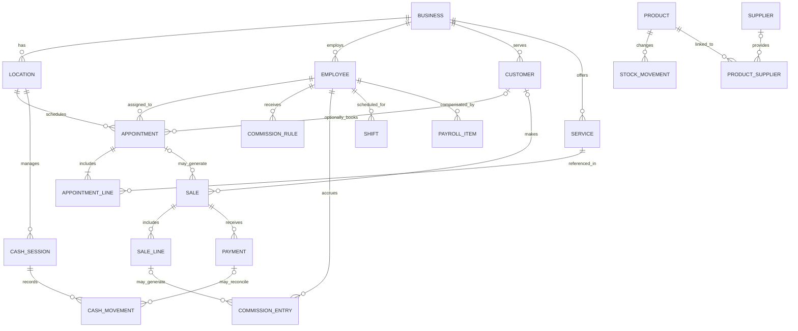

# Modelo conceptual propuesto (NO obtenido de la base de datos de Fresha)

## Estados candidatos (no observados íntegramente)
- Caja: `closed` → `open` → `closed`; reapertura de una sesión cerrada **pendiente de definir**, no asumir un estado real de Fresha.
- Cita: `reserved` / `confirmed` / `completed` / `cancelled` / `no_show` (**lista orientativa**, solo algunos textos son visibles).
- Venta: `draft` / `pending_payment` / `paid` / `refunded` (propuesta de nuestra app; no tratar como estados originales confirmados).
- Stock: libro mayor de movimientos, no editar contador sin rastro.

## Decisiones de implementación originales por definir
Políticas de concurrencia en caja, devoluciones, permisos por tenant/ubicación, historial inmutable, numeración de folios, divisas, impuestos, stock multialmacén, pagos mixtos, facturación y conciliación. Priorizar pruebas y diseño de seguridad antes de producir software real.
