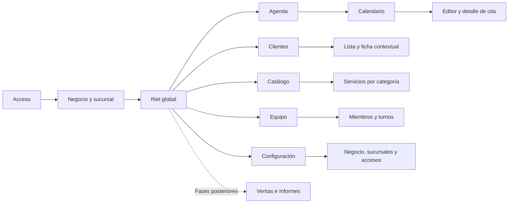

# Arquitectura de información de MAMBO JAMBO

**DECISION_PROPIA.** Las rutas, etiquetas y permisos son de MAMBO JAMBO. Se conserva la jerarquía riel global → menú contextual → lienzo → detalle. El riel cambia de familia. El menú local conserva la lista de pantallas de esa familia. El detalle mantiene visible el contexto cuando hay espacio. [Catálogo](../FOTOGRAMAS/INVENTARIO/085s.jpg) · [Ventas](../V03_EXPLORACION/065s_calendario.jpg) · [Ficha contextual](../05_EVIDENCIAS/FOTOGRAMAS/CLIENTES/t_006s.jpg)

## Rutas y jerarquía

Fases **M** MVP, **P** posterior, **R** reservada en mapa. Las rutas son relativas al contexto `/b/{negocio}/s/{sede}`, salvo donde se indica. Alta y edición de registros usan `nuevo` y `{id}/editar` cuando la fila declara ambas operaciones. Los permisos de lectura no conceden escritura.

| Riel y submenú | Ruta y presentación | Fase y permiso mínimo | Correspondencia |
|---|---|---|---|
| Acceso → Selector | `/acceso`, `/seleccionar-contexto` globales. Seleccionar negocio y sede según membresía. | M · sesión válida para elegir | S18 |
| Inicio | `/inicio` | R | S01 |
| Agenda → Calendario | `/agenda?fecha=AAAA-MM-DD&vista=dia`. Lienzo de calendario. `/agenda/citas/nueva`, `/agenda/citas/{id}`, `/agenda/citas/{id}/editar` en panel o vista completa. | M · `appointment.read`; guardar requiere `appointment.write` | S02–S03 |
| Ventas → Resumen, Caja, Citas, Ventas, Pagos, Artículos vendidos | `/ventas/resumen`, `/ventas/caja`, `/ventas/citas`, `/ventas`, `/ventas/pagos`, `/ventas/articulos`. Checkout en `/ventas/nueva`, detalle `/ventas/{id}`, caja en `/ventas/caja/{registro}` y sesión en `/ventas/caja/{registro}/sesiones/{id}`. | P · `sale.read` o `cash.read` según hijo; checkout `sale.checkout`; apertura, movimiento y cierre con permisos propios | S04, S07–S08 |
| Ventas → Tarjetas regalo, Bonos, Membresías | Familias de artículos vendidos asociadas a Ventas. | R | [Menú](../V03_EXPLORACION/065s_calendario.jpg) |
| Clientes → Lista | `/clientes`, `/clientes/nuevo`, `/clientes/{id}`, `/clientes/{id}/editar`. Pestañas Resumen, Datos, Citas y, con Ventas, Artículos. | M · `customer.read`; alta, edición y archivo con `customer.write` | S05 |
| Clientes → Segmentos, Fidelización y Reputación | `/clientes/segmentos`, `/clientes/segmentos/{id}`. Estándar/Personalizados son vistas de la misma lista. | P segmentos · `segment.read` y `segment.write`; R fidelización/reputación | S16 · [Menú](../V03_EXPLORACION/115s_menu_clientes.jpg) |
| Catálogo → Servicios | `/catalogo/servicios`, `/catalogo/servicios/nuevo`, `/catalogo/servicios/{id}`, `/catalogo/servicios/{id}/editar`. Categorías y resultados. | M · `service.read` y `service.write` | S06 |
| Catálogo → Productos | `/catalogo/productos`, `/catalogo/productos/nuevo`, `/catalogo/productos/{id}`, `/catalogo/productos/{id}/editar`. Bonos y membresías son familias reservadas. | P · `inventory.read` y `inventory.write`; R bonos/membresías | S09 |
| Catálogo → Gestión de inventario | `/catalogo/inventario` Existencias, `/catalogo/inventario/recuentos`, `/catalogo/inventario/pedidos`, `/catalogo/proveedores`. Listas con alta y detalle por registro. | P · `inventory.read` y `inventory.write`; publicar/recibir requiere permiso específico | S10–S11 |
| Equipo → Miembros, Turnos | `/equipo`, `/equipo/nuevo`, `/equipo/{id}`, `/equipo/{id}/editar`, `/equipo/turnos`. Ficha y editor de turno en contexto. | M · `team.read` o `shift.read`; respectivos permisos de escritura | S12–S13 |
| Equipo → Comisiones, Liquidaciones, Fichajes | `/equipo/comisiones`, `/equipo/liquidaciones`, detalle y asistente. | P comisiones/liquidaciones · `compensation.read`, permisos propios para regla, aprobación y registro; R fichajes | S14 · [Fichajes](../FOTOGRAMAS/EQUIPO/162s.jpg) |
| Informes → Biblioteca, Paneles | `/informes`, `/informes/{tipo}`, `/informes/paneles`. Categorías de negocio como filtro de biblioteca. | P · `report.read`; `report.export` para CSV | S15 |
| Configuración → Negocio, Sucursales, Accesos | `/configuracion/negocio`, `/configuracion/sucursales`, `/configuracion/sucursales/{id}`, `/configuracion/accesos`, `/configuracion/accesos/{id}`. Contexto y permisos de negocio revalidados al editar otra sede. | M · lectura y escritura explícitas de administración. R conectores/recargos | S17 |

## Reglas de navegación y ámbito

- Con sesión y una sola sede permitida, abrir destino autorizado o Agenda, o el primer destino autorizado si Agenda no está disponible. Con varias sedes y sin contexto válido, mostrar selector. Si ninguna está permitida, mostrar acceso pendiente y salida de sesión.
- Renderizar únicamente destinos habilitados por fase y permiso. Ocultar familias sin destinos activos. Ninguna sección futura aparece como opción operativa en MVP. Validar ámbito y permiso en el servidor tanto al leer como al mutar. En enlace directo, enviar a Acceso si expiró la sesión, mostrar acceso denegado para acción sin permiso y recurso no encontrado si el ID queda fuera del ámbito.
- Los enlaces de registro conservan filtro, fecha y pestaña no sensibles al abrir panel. Al cerrar, volver al origen autorizado con selección y posición recuperadas. Desde URL directa, volver al padre canónico. Atrás cierra una sola capa. Un detalle abierto desde Ventas → Citas vuelve a esa lista, y desde Cliente → Citas vuelve a su ficha. Los retornos se validan como rutas internas del mismo ámbito.
- La URL puede guardar fecha, vista e IDs opacos. Mantener nombres, teléfonos, correos o búsquedas por contacto fuera de la URL. Cambiar sede cierra los paneles y revalida filtros y permisos, con confirmación si hay un formulario sucio. Conservar la fecha si el destino tiene calendario y reconstruir la franja desde la zona de la sede nueva.
- Ante revocación durante una edición, retirar el contenido protegido, impedir el guardado, informar y ofrecer regreso al selector o a una pantalla autorizada. Los filtros de sede nunca amplían el acceso.

## Permisos propuestos para el piloto

| Perfil | Lectura y operación |
|---|---|
| Recepción | Agenda y clientes de sus sedes, consulta de servicios, miembros y turnos. Puede guardar citas y contactos operativos. |
| Responsable de sede | Facultades operativas de la sede y mantenimiento de servicios, miembros y turnos asignados. |
| Administración de negocio | Negocio, sucursales y membresías. Acceso operativo mediante permisos explícitos. |
| Caja y supervisión económica, fase posterior | Acceso a ventas y sesiones asignadas. Cierre, devolución, exportación y liquidación son facultades separadas. |

La [arquitectura anterior](../CODEX_REVERSE_ENGINEERING_BLUEPRINT/04_ARCHITECTURE.md) aporta el modelo de membresías. La matriz final requiere aprobación en [Alcance](MAMBO_JAMBO_IMPLEMENTATION_SCOPE.md).
