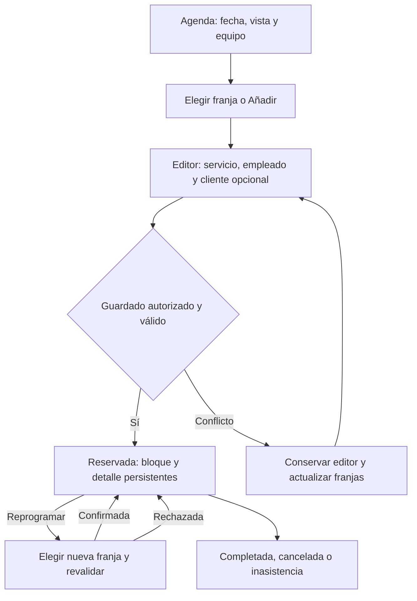

# Flujos de pantalla

**DECISION_PROPIA.** Las secuencias, excepciones y transiciones definen MAMBO JAMBO. Las fuentes al final de cada recorrido delimitan qué parte se observó. Las rutas y permisos están en la [arquitectura de información](MAMBO_JAMBO_INFORMATION_ARCHITECTURE.md), y las clasificaciones S01–S18 en [Correspondencia](FRESHA_TO_MAMBO_SCREEN_MAPPING.md).

## F01 · Acceso y configuración · MVP · S17–S18

1. Acceso → sesión válida → selector si hay varias sedes disponibles. Si existe destino interno autorizado, abrirlo. Si falta sede, mostrar acceso pendiente. Administración autorizada puede editar negocio, crear sucursal y gestionar acceso por acción y sede.
2. En Sucursales, validar nombre, moneda y zona IANA. Si ya hay citas o actividad económica asociada, el cambio de zona o moneda requiere una política de migración aprobada. Una revocación revalida el destino del usuario afectado y registra actor, ámbito y fecha.
3. Cambio de contexto → confirmar pérdida de borrador si existe → cargar destino disponible en la sede elegida. Si falla la lectura, conservar el contexto anterior autorizado y permitir reintentar. Sesión caducada → renovar → reabrir destino autorizado.

La evidencia confirma contexto de sede y ajustes locales. Inicio de sesión y concesión efectiva permanecen sin prueba directa. [Contexto](../INFORMES/seg_66.jpg) · [Equipo y permisos](../V03_EXPLORACION/215s_equipo_workspace.jpg)

## F02 · Preparar catálogo y disponibilidad · MVP · S06, S12–S13

1. Catálogo → Servicios → Nuevo. Completar nombre, categoría, duración positiva y precio no negativo. Guardar → ficha activa. Archivar bloquea selección futura y conserva servicio y valores históricos en citas existentes.
2. Equipo → Miembros → Nuevo. Registrar nombre, sede y servicios habilitados. Puede quedar sin cuenta de acceso. Abrir Equipo → Turnos, elegir miembro y sede, ingresar días, franjas y vigencia.
3. Validar fin posterior al inicio, intervalo local inequívoco y vigencia no contradictoria. Si modificar el turno dejaría una cita vigente sin cobertura, mostrar las citas afectadas y conservar el turno anterior. Tras guardar, volver a la semana editada. En agenda, actualizar elegibilidad para nuevas reservas.
4. Un cambio de precio o duración aplica a selecciones nuevas. Reprogramar conserva los valores capturados originalmente.

[Servicios](../FOTOGRAMAS/INVENTARIO/085s.jpg) · [Turno](../FOTOGRAMAS/EQUIPO/132s.jpg) · [Confirmación](../FOTOGRAMAS/EQUIPO/142s.jpg)

## F03 · Crear o modificar cita · MVP · S02–S04

1. Mostrar selección provisional, sede, fecha/hora local, empleado, servicio, duración y total; cliente opcional. El piloto admite un servicio y un empleado por cita. La hora procede de un hueco o de un selector accesible.
2. Confirmar elegibilidad, turno, franja y ausencia de solape activo. Dos guardados competidores sobre un mismo empleado, incluso en sedes distintas, producen una sola reserva. Si la respuesta se pierde, reconciliar el intento antes de crear otra cita.
3. Tras guardar, bloque y detalle muestran Reservada. Cerrar devuelve a la misma fecha, vista y empleado. Reprogramar conserva la reserva anterior hasta confirmar la nueva. Ante conflicto, conservar el editor con la franja intentada y ofrecer volver al detalle original.
4. Solo una cita Reservada cambia a Completada, Cancelada o Inasistencia en MVP. Cancelar pide confirmación y libera el hueco. Inasistencia y completar se habilitan desde la hora de inicio. Las transiciones guardan actor, hora y estado previo. Cobrar desde cita llega con Ventas y tiene su propio estado.
5. El fixture base reproduce duración 90 min y precio 25 MXN con cliente vacío. Probar el mismo recorrido con cliente, conflicto concurrente y edición desde Clientes → Citas.

[Secuencia grabada](../05_EVIDENCIAS/VIDEOS/ALTA_CITA.mp4) 42–55 s · [Menú de modificación](../05_EVIDENCIAS/FOTOGRAMAS/CITAS_MODIFICACION/t_03.5.jpg) · [T01–T02](../CODEX_REVERSE_ENGINEERING_BLUEPRINT/05_TEST_STRATEGY.md)

## F04 · Alta y consulta de cliente · MVP · S05

Clientes → Lista → Nuevo → nombre obligatorio y contacto opcional → guardar → ficha → Datos o Citas. Mostrar error junto al dato inválido. Si hay contacto coincidente, ofrecer abrir la ficha autorizada o continuar según la política aprobada. Archivar confirma efecto, mantiene historial y retira la ficha de los selectores nuevos. Desde Agenda, seleccionar cliente existente y volver al editor con la misma franja. La configuración de consentimientos depende de D04. [Ficha](../05_EVIDENCIAS/FOTOGRAMAS/CLIENTES/t_006s.jpg) · [Alta histórica](../WORK_PRIMERA_PASADA/08_EVIDENCE/RECOVERY_CHECKPOINT.md)

## F05 · Venta y caja · posterior · S04, S07–S08

1. Ventas → Caja → Abrir registro. Mostrar efectivo sugerido de la sesión cerrada anterior, permitir cambio con motivo y validar que no haya otra sesión abierta. Caja abierta → Resumen/Actividad → Entrada o Salida → importe positivo y motivo → registrar evento con actor y hora. Reintento idéntico devuelve el mismo evento.
2. Ventas → Nueva, o Cita → Cobrar → borrador único para esa cita. Mantener líneas y precio históricos. Checkout → propina opcional → Efectivo → recibido y cambio → confirmar. Validar sesión activa, importe y revisión del total. Pago, folio y movimiento de caja quedan confirmados juntos. Sin caja abierta, conservar borrador y permitir volver a Caja. El pago no cambia por sí solo el estado de la cita.
3. Ante respuesta incierta, mostrar operación pendiente y consultar su resultado. Confirmación → recibo → volver a la lista o cita de origen. Lista y recibo muestran el mismo folio. Validar 25 + 6,25 de propina, 40 recibidos, 8,75 de cambio y 31,25 ingresados.
4. Cerrar Caja → arqueo con esperado, contado y diferencia = contado − esperado → motivo de diferencia → retenido + retiro = contado → confirmar → sesión cerrada. Si entra un movimiento antes del corte, incluirlo y pedir revisar el nuevo saldo. Si el cierre gana la carrera, rechazar el movimiento sin efectos parciales. La próxima apertura sugiere el efectivo retenido. Ajustes posteriores referencian la sesión cerrada.

Efectivo y arqueo tienen prueba directa. La cadena completa desde cita hasta caja y la política de corrección son del producto propio. [Venta](../VIDEOS/REGISTRO_VENTA.mp4) 36–62 s · [Arqueo](../VIDEOS/CAJA_CIERRE.mp4) 43–57 s · [Apertura](../VIDEOS/CAJA_ROLLOVER.mp4) 98–110 s

## F06 · Producto, proveedor y existencias · posterior · S09–S11

1. Catálogo → Proveedores → Nuevo → guardar identidad y contacto → ficha. Desde Productos → Nuevo, completar identidad, precio y seguimiento. Si corresponde, asignar proveedor y registrar stock inicial por sede. Mostrar SKU duplicado u otro error al lado del campo. Guardado vuelve a ficha o al editor de origen.
2. Pedido: borrador → ordenado → recibido parcial → recibido. Elegir proveedor y líneas, registrar cantidad por sede y validar remanente. Repetir la misma recepción no suma stock. Cancelación del remanente preserva lo recibido.
3. Recuento: borrador → conteo → revisión → aplicado. Mostrar esperado, contado y diferencia por producto. Si el saldo cambió durante el conteo, volver a revisar con los datos preservados. Publicación autorizada registra un movimiento una sola vez. Venta y devolución física se prueban antes de habilitar ese catálogo en POS.

[Producto](../FOTOGRAMAS/INVENTARIO/175s.jpg) · [Proveedor](../FOTOGRAMAS/INVENTARIO/225s.jpg) · [Revisión de recuento](../FOTOGRAMAS/INVENTARIO/040s.jpg)

## F07 · Comisión y registro de liquidación · posterior · S14

Equipo → Comisiones → seleccionar miembro, tasa, familia y vigencia → revisar → guardar regla versionada. Rechazar tasa inválida o vigencia solapada en el mismo ámbito. Equipo → Liquidaciones → miembro/período → detalle de devengos y propinas → aprobar → registrar pago externo con referencia. Sin revisión o permiso, conservar borrador y señalar el paso pendiente. Una devolución crea un ajuste vinculado a la línea original. Volver al detalle con estado y fecha de registro. [Regla guardada](../FOTOGRAMAS/EQUIPO/98s.jpg) · [Revisión](../FOTOGRAMAS/EQUIPO/195s.jpg) · [Resultado de propina](../FOTOGRAMAS/EQUIPO/234s.jpg)

## F08 · Informes y segmentos · posterior · S15–S16

- Informes → Biblioteca → categoría → informe → elegir sede, período y dimensión → aplicar → consultar tabla, definición y corte. Filtro sin coincidencias ofrece restablecer. Error ofrece reintentar con la selección preservada. Exportación, cuando se habilite, revalida permisos al descargar. Regreso conserva categoría. [Biblioteca](../V03_EXPLORACION/265s_informes_categorias.jpg) · [Citas](../INFORMES/seg_66.jpg)
- Clientes → Segmentos → tipo → condiciones y ventana → vista previa de conteo → guardar versión → lista. Condición incompleta devuelve error junto al operador o valor. El conteo usa el corte indicado. Guardar regla no envía comunicaciones. [Guardado estándar](../05_EVIDENCIAS/VIDEOS/CLIENTES.mp4) 55–72 s
