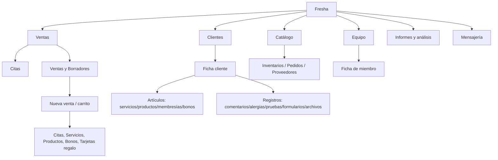

# Fresha — Investigación por grabación de pantalla (V03)

**Fuente:** Grabación de pantalla del 17/11/2026, duración **05:33**, resolución 1440×772, 60 fps. Se revisó una muestra temporal representativa y capturas de momentos clave. La grabación original fue aportada por el usuario y **no está incluida en este ZIP** para reducir el tamaño. Las capturas incluidas ocultan datos de contacto/dirección cuando aparecen.

## Qué significa el nivel de evidencia

- **INTERFAZ VISTA:** la pantalla, opción, campo o estructura aparece claramente en la grabación.
- **NAVEGACIÓN VISTA:** se observa cambio de pantalla o apertura de pestañas/menús.
- **INICIO DE FLUJO:** se muestra el primer formulario o asistente, pero no su conclusión.
- **PANTALLA PROMOCIONAL:** Fresha describe una capacidad comercial; **no es una verificación del funcionamiento**.
- **NO PROBADO:** no hay evidencia de guardado, cobro, errores, reglas de cálculo, permisos efectivos, backend o APIs.

## Cronología y hallazgos

### 00:00–00:38 — Ficha de cliente

- La ficha aparece como panel superpuesto a la tabla `Ventas > Citas`, con cabecera que contiene identidad del cliente y acciones `Acciones` y `Reservar ahora`.
- Tiene navegación interna `Resumen`, `Citas`, `Ventas`, `Datos del cliente`, `Artículos`, `Registros`, `Billetera`, `Programa de fidelidad`, `Reseñas`.
- `Datos del cliente` (00:15): muestra campos adicionales, etiquetas, direcciones, contactos de emergencia, notificaciones por canales, y política de pago; se ve botón `Editar`. No se edita ni guarda información.
- `Artículos` (00:25): pestañas `Servicios`, `Productos`, `Membresías` y `Bonos`; la vista de bonos está vacía. `Registros` se expande a `Comentarios`, `Alergias`, `Pruebas cutáneas`, `Formularios` y `Archivos`.
- `Programa de fidelidad` (00:35) muestra una pantalla promocional de activación: **no hay prueba de puntos, saldo o canjes reales**.

### 00:40–01:10 — Calendario

- Se vuelve a `Calendario` y se observa la vista por personal. No se comprueba creación, reprogramación ni prevención de solapamientos en este fragmento.

### 01:10–01:35 — Venta nueva / punto de venta

- `Nueva venta` muestra las etapas `Carrito > Propina > Pago` y una columna lateral de cliente/carrito.
- Categorías visibles en el carrito (01:15): `Citas`, `Servicios`, `Productos`, `Bonos`, `Tarjetas regalo`, además de búsqueda y `Venta rápida` con servicios sugeridos.
- El carrito muestra estado vacío y acción `Añadir cliente`, que explícitamente puede dejarse vacío para clientes sin cita previa.
- Al entrar a `Servicios` (01:25) aparece un catálogo con el nombre del servicio, duración y precio. Hay dos servicios de muestra a 25 MXN y 1 h 30 min.
- **No hay captura de un artículo añadido, paso de propina, selección de pago ni venta finalizada.** Los nombres de etapas se observan, pero su comportamiento no está validado.
- Historial de `Ventas` (01:35): pestañas `Ventas` y `Borradores`, búsqueda, filtro de fechas, filtros adicionales, acción `Añadir nueva` y estado sin resultados.

### 01:35–01:55 — Ventas y clientes

- Pantalla de `Membresías vendidas`: búsqueda por membresía o cliente, filtro de fecha, filtro `Todos los estados`, exportación.
- Menú `Clientes`: `Lista de clientes`, `Segmentos de clientes`, sección `Fidelización` con `Programa de fidelidad` y `Reputación online`. Algunos destinos cargan y otros muestran pantallas promocionales; no hay flujo transaccional completo.

### 02:00–02:55 — Catálogo e inventario

- Menú `Catálogo`: `Menú de servicios`, `Bonos`, `Productos`; bajo `Gestión de inventario`: `Inventarios`, `Pedidos de stock`, `Proveedores`.
- La página `Productos` contiene una pantalla introductoria que anuncia importación por lotes, marcas/categorías, alertas de stock y conexión con ventas (02:25–02:35). **Son capacidades anunciadas, no operaciones verificadas.**
- Se abre `Crear un nuevo inventario` (02:45): paso `Añadir la información del inventario`, asociación a una ubicación existente, opción `Cambiar`, `Nombre del inventario (Opcional)`, `Descripción del inventario (Opcional)` y contador visible 0/200; controles `Cerrar` y `Empezar inventario`.
- La grabación no demuestra guardar ni ejecutar el recuento, ajustar stock, realizar pedido o administrar proveedores.

### 02:55–03:10 — Mensajería

- Se observa en la navegación `Mensajería > Campañas de difusión`, `Automatizaciones`, `Historial de mensajes`; `Promoción > Ofertas`, `Precios inteligentes`.
- Un asistente enseña `Resumen de los recargos` (03:05), con importes visibles de SMS y email. **Son tarifas mostradas en esa sesión y no deben considerarse precios actuales ni reglas de negocio generales.** No se envía ningún mensaje.

### 03:10–04:15 — Equipo

- `Equipo` muestra `Miembros del equipo`, `Turnos programados`, `Fichajes digitales`, `Procesos de pago`.
- Lista de miembros: búsqueda, filtros, orden personalizado, selección por checkbox, columnas `Nombre`, `Contacto`, `Rol de permisos`, `Acciones`; en esta cuenta se muestran dos miembros, uno con rol `Propietario del espacio de trabajo` y otro `Sin acceso`.
- Al abrir un miembro se accede a panel de ficha con apartados `Resumen`, `Datos personales`, `Workspace`, `Pagar`.
- `Datos personales` incluye identidad, datos de contacto, calendario de reservas, puesto y empleo, con botón editar.
- `Workspace` muestra servicios asignados, calendario de reservas, rol de permisos, calendarios asociados y establecimiento. El perfil de demostración tiene `Sin acceso` y acción `Otorgar acceso`.
- El menú `Acciones` para un miembro ofrece `Editar`, `Ver calendario`, `Ver turnos programados`, `Añadir días libres`, `Archivar` (03:55).
- **No se verifica guardar cambios de permisos, procesar nómina ni efecto de archivar.**

### 03:45–04:45 — Informes y pagos de equipo

- La biblioteca `Informes y análisis de datos` muestra 64 informes en la interfaz; categorías `Ventas`, `Finanzas`, `Citas`, `Equipo`, `Clientes`, `Gestión de inventario`, `Otros`.
- Navegación adicional: `Todos los informes`, `Favoritos`, `Paneles de control`, `Estándar`, `Prémium`, `Personalizado`, `Carpetas`, `Sincronización de datos`.
- Se identifican cinco paneles anunciados en el catálogo, incluidos rendimiento, presencia online, fidelidad, recepcionista virtual con IA y sitio web inteligente. **No se abren los reportes individuales ni se confirman sus métricas o exportación.**
- `Procesos de pago` muestra una pantalla informativa que anuncia salarios, comisiones, propinas y bonificaciones; **no se observa una liquidación operativa**.

### 04:50–05:33 — Navegación ajena a Fresha

- La grabación pasa a navegación externa/búsqueda en Google. Esta parte no aporta evidencia funcional adicional de Fresha.

## Arquitectura de navegación observada

## Qué NO demuestra esta grabación

- Apertura, entrada, salida y cierre de **Caja** (esos temas se documentaron en capturas anteriores, no en este video).
- Venta completada, cálculo final de impuestos, propina y liquidación, o integración de un cobro a la caja.
- Inventario guardado, movimientos de stock, importación, proveedores o pedidos ejecutados.
- Permisos probados con dos usuarios diferentes.
- Código fuente real, HTML extraído, JavaScript, CSS, tráfico HTTP, contratos reales de API o esquema interno de base de datos.

## Próximos recorridos con mayor valor técnico

1. **Caja:** entrada, salida, historial, cierre y arqueo con datos ficticios; observar saldo previo y posterior.
2. **Punto de venta:** seleccionar un servicio, añadir al carrito, revisar descuentos, propina, pago y guardar solo si es seguro.
3. **Inventario:** completar creación ficticia y registrar el recorrido hasta el recuento sin cambios de stock no deseados.
4. **Equipo:** abrir formulario de permisos para registrar campos, sin conceder acceso a terceros.
5. **Informes:** abrir un informe real, revisar sus filtros y la exportación; la lista de 64 no equivale a 64 informes estudiados.

## Transferencia a Codex

Usa estas notas como evidencia de UX y navegación. Considera todo comportamiento interno desconocido salvo cuando la interacción observada lo demuestra. Diseña arquitectura original, validaciones y pruebas a partir de requisitos explícitos, no mediante suposiciones presentadas como hechos. Las capturas son material de estudio, no código propietario reutilizable.
