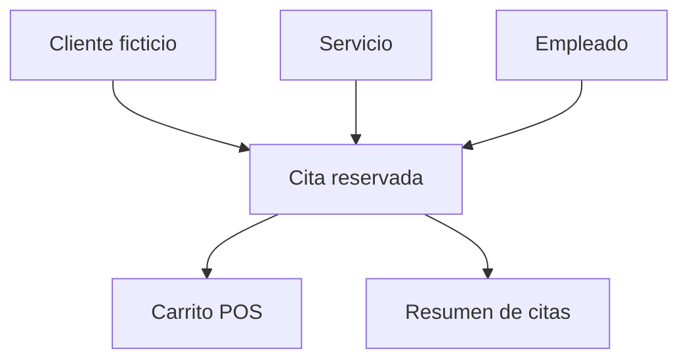
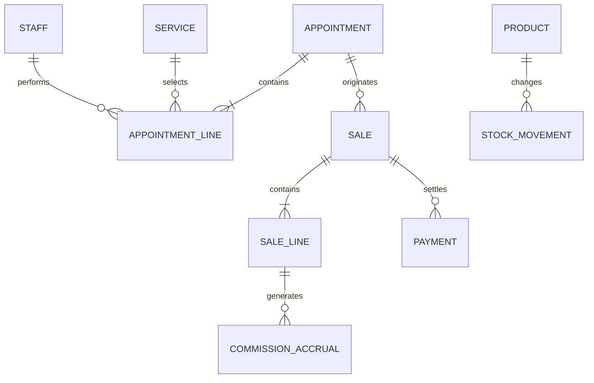

# Relaciones observadas e inferidas
Cadena histórica observada hasta carrito, reporte leído después (E01):

No flecha pago→comisión→reportes porque no se comprobó.
Modelo para implementación propia, INFERIDO:

Cardinalidades propuestas, incluidas venta opcional y pagos múltiples; no reconstrucción de esquema real.
